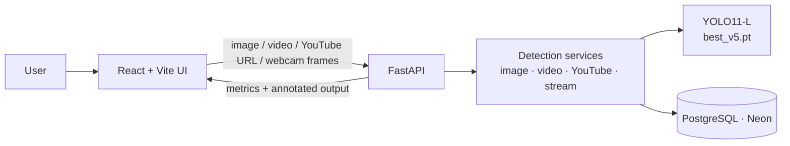

<h1 align="center">🔍 Brand Detector — Real-time Logo Detection with YOLO11</h1>

<p align="center">
  Detects car-brand logos in images, uploaded videos, YouTube links and live webcam streams,<br/>
  and measures how long and how often each brand appears on screen.
</p>

<p align="center">
  
  
  
  
  
  
  
  
</p>

---

## 🎯 The problem

Sponsors and marketing teams pay for brand visibility in sports broadcasts, events and online video, but measuring *how much* screen time a logo actually gets is still mostly manual. This project automates it: feed it an image, a video, a YouTube URL or a live camera, and it returns which brands appear, for how many frames and what percentage of the content.

## 📊 Model results

Custom **YOLO11-L** model fine-tuned on a hand-built dataset of logo frames (Mazda, Mercedes-Benz, Toyota), labelled in Roboflow.

| Metric (validation set) | Value |
|---|---|
| **mAP@50** | **0.965** |
| mAP@50-95 | 0.793 |
| Precision | 0.972 |
| Recall | 0.915 |

Training setup: YOLO11-L pretrained weights · 100 epochs · 640 px · batch 16 · early-stopping patience 50.

## ✨ Features

- **4 input modes**: single image, uploaded video, YouTube link and **real-time webcam streaming**
- **Visibility metrics** per brand: detected frames, screen time, % of appearance, FPS
- **Asynchronous video jobs** with status polling, so long videos don't block the UI
- **Persistence** of every analysis in PostgreSQL (Neon): `videos` and `logo_detector` tables
- **Production-minded API**: structured logging, rate limiting, request-size limits, security headers, centralised error handling and file validation

## 🏗️ Architecture

<p align="center">
  
</p>



## 👤 My role

This was a 5-person team project at the Factoría F5 AI Bootcamp. I was one of the two main code contributors and focused on the model and the real-time pipeline:

- **Dataset & training** — extracted and labelled many frames per brand, and trained and iterated the YOLO models (v8 → YOLO11) until reaching the final `best_v5.pt`
- **Image and video detection** — detection on images and videos, frame sampling and the visibility metrics
- **YouTube and live streaming** — processing of YouTube links and the real-time webcam mode
- **Integration** — connected the React result viewer, video player and webcam component with the FastAPI backend, and did the final refactor that got image and video working end to end

## 🚀 Run it locally

```bash
git clone https://github.com/mr-melenas/brand-detector-yolo.git
cd brand-detector-yolo

# Backend
python -m venv .venv && source .venv/bin/activate   # Windows: .venv\Scripts\activate
pip install -r requirements.txt
cp .env_example .env      # add your PostgreSQL / Neon connection string
cd backend && uvicorn main:app --reload             # http://localhost:8000/docs

# Frontend (new terminal)
cd frontend && npm install && npm run dev           # http://localhost:5173
```

> A GPU is recommended for real-time video and webcam. Image detection runs fine on CPU.

## 📁 Project structure

```
backend/
├── main.py              # FastAPI app, middleware and lifespan
├── routes/              # upload_image, upload_videos, youtube_video, stream, health
├── services/            # image, video, YouTube and streaming detection services
├── core/                # logging, exceptions, middleware
├── database/            # Neon/PostgreSQL connection and inserts
└── best_v5.pt           # trained YOLO11-L weights
frontend/
└── src/                 # React pages, ResultViewer, WebcamStream, YoutubeInput…
```

## 🔭 Next steps

- Public demo on Hugging Face Spaces (image + short video)
- More brands and a larger dataset
- Export to ONNX / TensorRT for faster CPU and edge inference

## 👥 Team

Built at [Factoría F5](https://factoriaf5.org/) by [@mr-melenas](https://github.com/mr-melenas) (Max Beltrán), [@Yael-Parra](https://github.com/Yael-Parra), [@alharuty](https://github.com/alharuty), [@odar1997](https://github.com/odar1997) and [@Stephyangeles](https://github.com/Stephyangeles).
Original team repository: [Yael-Parra/Brand_Detector_Project](https://github.com/Yael-Parra/Brand_Detector_Project).
